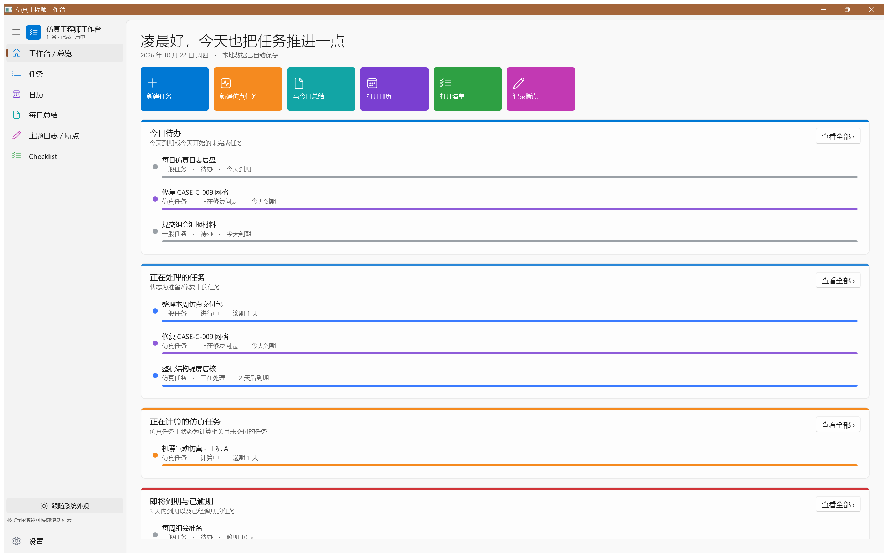

# 仿真工程师个人工作台（Vibe ColorfulTime）

面向仿真工程师的 **Windows 桌面个人工作台**：把仿真计算任务、一般待办、日历、每日总结、主题日志/断点、Checklist 统一到一个本地应用中，并支持界面布局与可选模块的个性化开关。

- 技术栈：**C# + WinUI 3（Windows App SDK 1.8）**，本地 **SQLite** 存储，无网络依赖。
- 视觉风格：**UWP / Windows Phone** 风格——轻量大标题、纯色强调磁贴、模块主题色、状态颜色条；支持浅色 / 深色 / 跟随系统。
- 当前版本：`v0.1.0-p0`（P0 功能已完成并通过数据层 + UI 端到端自检）。



## 功能一览（P0）

| 模块 | 能力 |
| --- | --- |
| 工作台 | 可自定义显示/排序的卡片：今日待办、处理中任务、计算中仿真任务、即将到期/逾期、今日及近期日程、最近断点、最近每日总结、Checklist 进度 |
| 任务 | 仿真任务与一般任务统一管理；创建/编辑/删除、列表、详情、搜索与多条件筛选；手动维护计算所需时间、创建日期、计划交付、实际交付；仿真专属字段（算例、工况、计算备注） |
| 状态 | 七种初始仿真状态（待进行/正在处理/计算中/计算完成/后处理完成/计算中止/正在修复问题）与三种一般状态，均可改名、改色、排序；删除使用中的状态必须先迁移任务 |
| 日历 | 月视图；展示任务计划开始、计划交付与周期实例；点击日期查看当天安排，条目颜色等于状态颜色 |
| 周期性任务 | 每日/每周/每月 + 自定义间隔；每周指定星期、可选结束日期；每次执行生成**独立任务实例**；支持跳过某次、单次修改、规则重建 |
| 每日总结 | 按日期持续编辑同一份记录；今日总结/完成事项/问题处理/待处理/明日计划；可关联当日任务与 Checklist |
| 主题日志 / 断点 | 长期主题记录 + 当前断点；更新断点时旧断点与旧内容**自动进入历史**；支持类别、标签、搜索筛选 |
| Checklist | 多清单、检查项增删改/排序/勾选、进度统计；可关联任务、每日总结、主题日志 |
| 界面与模块 | 导航入口显示/隐藏与排序、首页卡片显示/隐藏与排序、默认首页、主题、恢复默认布局；可选模块启用/停用（数据始终保留） |
| 数据 | SQLite 本地持久化、启动自动迁移、JSON 备份导出与导入（合并/替换）、数据目录可配置（`--data-dir`） |

## 运行

### 环境要求

- Windows 10 1809+ / Windows 11
- .NET 8 SDK（`net8.0-windows10.0.19041.0`）
- Visual Studio 2022（含“使用 C++ 的桌面开发”和 Windows SDK 10.0.19041+）或仅 .NET SDK + MSBuild

### 构建与启动（命令行）

```powershell
# 还原 + 构建整个解决方案
dotnet build SimWorkbench.sln

# 运行（未打包模式，Windows App SDK 自包含，无需安装运行时）
.\src\SimWorkbench.App\bin\x64\Debug\net8.0-windows10.0.19041.0\win-x64\SimWorkbench.exe
```

> 本地开发脚本（构建/签名/启动）保留在开发者环境，不随仓库分发。

### 数据存储位置

- 默认：`%LOCALAPPDATA%\SimWorkbench\workbench.db`（备份在 `backups\`，日志在 `logs\`）
- 若默认目录不可写，会依次回退到“文档\SimWorkbench”、程序目录旁 `data\`
- 可用 `--data-dir <路径>` 或环境变量 `SIMWORKBENCH_DATA_DIR` 指定便携数据目录

## 测试

自检工具（数据层 92 项、UI 自动化 31 项、演示数据生成、截图脚本）保留在开发者本地环境，不随仓库分发；
发布前会执行并记录结果，验收标准与历史结果见 [docs/P0_CHECKLIST.md](docs/P0_CHECKLIST.md)。

## 架构

```
src/
  SimWorkbench.Core/   领域模型、服务接口、周期规则计算、默认数据（纯业务，无 UI/存储依赖）
  SimWorkbench.Data/   SQLite 架构与迁移、各业务服务实现、备份导入导出、服务组合根
  SimWorkbench.App/    WinUI 3 界面层：外壳导航、主题、页面、对话框、展示模型

```

界面层只通过 `SimWorkbench.Core` 中的服务接口访问业务能力，`SimWorkbench.Data` 负责实现，二者不相互引用；界面层通过 `WorkbenchServices` 组合根获得服务。详见 [docs/ARCHITECTURE.md](docs/ARCHITECTURE.md)。

## P0 验收对照

逐条验收标准（文档第 13 节）的完成情况与验证方式见 [docs/P0_CHECKLIST.md](docs/P0_CHECKLIST.md)。

后续需求与排期（拖动排序、任务条个性化、预计计算时间、计算完成提醒等）见 [docs/BACKLOG.md](docs/BACKLOG.md)。

## 已知限制 / 未实现（明确不做假功能）

- AI 助手、网络 API 连接器、自动仿真状态监测、通知自动化、第三方插件系统：**当前版本未实现**，模块管理中标记为“不可用（未实现）”，不提供可点击的假开关。
- 看板视图、日历周/日视图与时间段安排、Checklist 模板、全局搜索、导航拖拽排序、统计报表：列为 P1/P2。
- 周期任务“修改本次及以后实例”的粒度重建为 P0 简化实现（重建今天及以后的实例，历史实例保留）。
- 一般任务与仿真任务状态集合的“共享”通过设置项（一般任务可使用仿真状态集合）实现，未实现任意集合组合。

## 版本记录

- `v0.1.0-p0`：P0 全功能 + 多彩 UWP/Windows Phone 风格界面 + 明暗主题 + 数据/UI 端到端自检。
